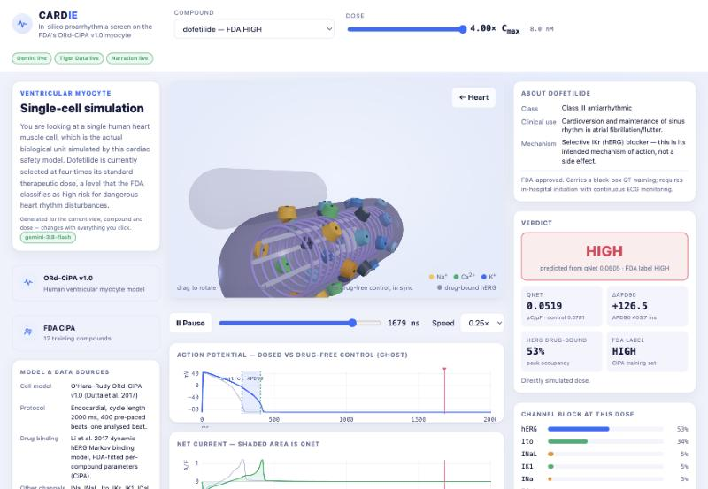

# Cardie


https://github.com/user-attachments/assets/f7f0f97c-2ac3-4ed0-a0f0-d0165e187dc7


**In-silico cardiac proarrhythmia screen with a live, animated heart cell.**

Molecule → per-ion-channel block → human ventricular myocyte simulation →
torsade-de-pointes risk class, scored against the FDA's own labels.

**[Try it live](http://104.207.131.198)** &middot; [demo video](demo/cardie_demo.mp4)

[](demo/cardie_demo.mp4)

The centrepiece is a WebGL cardiomyocyte you can poison in real time. Every
channel of that animation is bound to a real state variable from the FDA's
cell model: the membrane colour *is* membrane potential, the contraction *is*
the calcium transient, and the drug molecules plugging the hERG channels are
the Markov binding model's own occupancies. Nothing in it is hand-tuned.

The page also answers the three questions a first-time viewer actually asks,
up front rather than buried in a footer:

- **What is this drug?** An "About &lt;compound&gt;" card gives the drug
  class, clinical use, mechanism, and regulatory status for each of the 12
  — including *why* ranolazine and verapamil are the field's standard
  counter-examples to a hERG-only view of risk.
- **What model and data is this?** A "Model & data sources" card states the
  cell model, protocol, drug-binding model, and metric in plain terms,
  always visible, not just in this README.
- **What does the drug actually do to the heart?** The action-potential
  chart now shades the gap between the drug-free and dosed APD90 directly —
  the prolongation *is* the shaded region, not something to eyeball between
  two overlaid lines — a transmural-heterogeneity panel overlays three real
  cell-layer solves (Endo/Epi/Mid) to show the actual re-entry mechanism
  behind torsade de pointes, and a cross-drug comparison panel puts all 12
  compounds' simulated membrane potential side by side at one moment in the
  beat, backed by a live Tiger Data query.
- **What am I looking at right now?** A left-column panel narrates the
  current view in plain English — whole heart vs. single myocyte — and
  regenerates on every stage change, drug change, and dose change. It's
  Gemini-backed with the same offline fallback as the risk explanation, and
  it explains the *view*, not the *verdict* (that's the separate "Why" card).

---

## Quick start

```bash
git clone https://github.com/KaterinaM2006/cardie.git
cd cardie
./setup.sh                  # SUNDIALS, venv, both data repos, control-beat check
.venv/bin/python app.py     # http://localhost:5000
```

`setup.sh` is safe to re-run and takes about four minutes the first time.
It ends by printing `control qNet=0.0781 APD90=277.2` — if you see that,
the pipeline is correct and the rest is assembly.

To enable the optional sponsor integrations (Tiger Data, Gemini,
ElevenLabs), copy `.env.example` to `.env` and fill in the keys you have —
`app.py` loads it automatically. None are required: the app runs fully
without any of them, and the header pills say which are live.

`data/sweep.json` is committed, so the app runs immediately — no simulation
needed to demo. To regenerate it (~7 min on 4 cores), or to run the tests:

```bash
.venv/bin/python sweep.py          # prints a table that must match §3, row for row
.venv/bin/python -m pytest tests/ -q   # 42 tests, ~40 s
```

The page opens on the heart. Click it to descend into the myocyte; `Esc` or
the **← Heart** button goes back. Drag to rotate, hover a channel for its
instantaneous current, space bar pauses.

**Troubleshooting**

| Symptom | Cause |
|---|---|
| `fatal error: sundials/sundials_config.h` | SUNDIALS missing, or installed *after* Myokit. Install it, then reinstall Myokit. |
| `error: externally-managed-environment` | Installing into the system Python. Use the venv `setup.sh` creates. |
| `myokit.Sundials.version()` prints `None` | Same as the first row — Myokit cannot see SUNDIALS. |
| Blank 3D panel | No WebGL. Check `chrome://gpu`; the charts and numbers still work. |
| App starts but the page 404s | Run `app.py` from the repo root, not from `static/`. |

**SUNDIALS must be installed before Myokit**, or the first simulation fails
with `fatal error: sundials/sundials_config.h: No such file or directory`.
`setup.sh` does this in the right order and verifies it.

---

## What it computes

Protocol: endocardial cell (`cell.mode = 0`), cycle length 2000 ms, 0.5 ms
stimulus, 400 pre-paced beats, one analysed beat.

$$q_{\mathrm{Net}} = \int \left(I_{\mathrm{NaL}} + I_{\mathrm{CaL}} + I_{\mathrm{to}} + I_{\mathrm{Kr}} + I_{\mathrm{Ks}} + I_{\mathrm{K1}}\right)\,\mathrm{d}t$$

in µC/µF over the beat, averaged over 1×, 2×, 3× and 4× Cmax. This is the
CiPA metric, and it separates the three risk classes far better than ΔAPD90.

**Control (drug-free): qNet = 0.0781 µC/µF, APD90 = 277.2 ms.**

| Classifier | Accuracy on the 12 | Thresholds |
|---|---|---|
| qNet, mean over 1–4× Cmax | **12 / 12** | HIGH < 0.0663 < INTERMEDIATE < 0.0784 < LOW µC/µF |
| ΔAPD90 at 4× Cmax | 10 / 12 | HIGH > 80.1 ms > INTERMEDIATE > 31.9 ms > LOW |

ΔAPD90 misclassifies ranolazine and verapamil, both known CiPA outliers. It
is kept on screen anyway because it is the number a non-specialist
understands, and because where it disagrees with qNet is itself the argument
for using qNet.

### Transmural heterogeneity (Endo/Epi/Mid)

The classification above is single-cell, endocardial only (`cell.mode = 0`),
exactly as the FDA validates it. The `[cell]` component of the `.mmt` also
defines `mode = 1` (epicardial) and `mode = 2` (mid-myocardial, the "M
cell") — a plain literal constant, so `Engine.run(mode=...)` can switch cell
type with `set_constant()`, no recompile.

This isn't decoration. Real transmural dispersion of repolarisation — how
much longer the M cell layer stays depolarised than the epicardium — is the
textbook re-entry mechanism behind torsade de pointes. `sweep.py` now runs
all 12 drugs × 4 doses at all three modes (`--no-transmural` skips modes
1/2 for a faster dev sweep), stored additively as `control_by_mode` /
`drugs[name].doses_by_mode` so the existing endocardial `control` / `doses`
— and the acceptance check against them — are untouched.

Drug-free baseline (prepace 400, this machine): Endo APD90 277 ms, Epi
228 ms, Mid 351 ms — a 123 ms baseline dispersion before any drug is even
applied. Quinidine at 4× Cmax, which only just fails to repolarise
endocardially, fails outright in the M cell layer at the same dose.

This view is additive and illustrative, shown alongside the validated qNet
classification, not folded into it — there is no FDA-validated threshold for
a "dispersion risk classifier," and inventing one would be exactly the kind
of overclaiming this project otherwise avoids.

### Two limits, stated up front

- **12 compounds, not 28.** The fitted dynamic-hERG binding parameters exist
  only for the CiPA training set. The wider 28-drug validation set is not in
  the FDA repo and re-fitting it is a multi-day job.
- **The thresholds are fitted on the same 12 compounds they are evaluated
  on.** 12/12 is a *separability* result, not held-out accuracy. This is
  stated on the page as well as here.

The published CiPA thresholds sit slightly lower (≈0.0581 / 0.0671) because
the FDA initialises from a stored CL-2000 steady state rather than pre-pacing
from the model's defaults. The ordering is what matters, and it reproduces
exactly.

**Non-goals.** No whole-body PBPK, no "digital twin" of a person, no claim
about any identified individual. This is preclinical compound screening.

---

## Architecture

```
  SMILES / drug name
          │
  1. pharmacology adapter    measured | nearest-analogue   pharmacology.py
          │                  {channel: (IC50_nM, hill_h)} × 6
          │                  + hERG {Kmax, Ku, n, halfmax, Vhalf}
          ▼
  2. EP engine (myokit)      qNet, APD90, 300-frame bundle  engine.py
          │                  V, Ca_i, 7 currents, hERG open + bound
          ├──────────────►   Tiger Data hypertable           tiger.py
          ▼
  3. risk classifier         qNet → LOW | INTERMEDIATE | HIGH  classifier.py
          │
          ▼
  4. Flask API    ──► Gemini: explain verdict / narrate view / parse NL
          │                                        app.py, explain.py
          │        ──► drug_info.py: clinical context per compound
          ▼
  5. web UI    animated myocyte + charts + narration   static/
                (narration: the browser's own voice reads the Why text —
                 no backend call, no key)
```

Module 1 is the only place with more than one implementation; everything
downstream is identical regardless of where the IC50s came from. That is what
lets the UI show measured and predicted side by side without a second
pipeline.

| File | Role |
|---|---|
| `engine.py` | ORd-CiPA v1.0 simulation. Compile once, vary with `set_constant()`. |
| `sweep.py` | Precompute 12 drugs × 4 doses × 3 cell modes → `data/sweep.json`, and check the endocardial pass against the reference table. |
| `classifier.py` | Two thresholds on qNet; confusion matrices for both metrics. |
| `pharmacology.py` | Measured lookup and Morgan/Tanimoto nearest analogue. |
| `tiger.py` | TimescaleDB hypertable, continuous aggregate, compression. |
| `explain.py` | Gemini verdict explanation + view narration + NL query, with offline fallbacks. |
| `drug_info.py` | Hand-curated clinical reference (class, use, mechanism, status) per compound. |
| `app.py` | Flask JSON API, serves the precomputed bundle from memory. |
| `static/signals.js` | The mapping layer: simulated state → colour, contraction, glyph state. |
| `static/cell3d.js` | The WebGL myocyte. |
| `static/charts.js` | AP and net-current canvases, qNet strip plot. |

### The animated cell

| Visual element | Driven by |
|---|---|
| Membrane fill colour | `membrane.V`, −88 mV indigo → +45 mV amber |
| Cell shortening + striation spacing | `calcium.Ca_i`, 0–7%; lags the upstroke, as it should |
| Channel pore opening, ion particle streams | per-channel \|I\|; inward for Na⁺/Ca²⁺, outward for K⁺ |
| hERG glyphs drawn open | `ikr.O` |
| Drug molecules plugging hERG | `ikr.Obound + ikr.IObound + ikr.Cbound` |
| Ghost cell behind | the drug-free control run, in sync |
| "Repolarisation failure" banner | `APD90` is `NaN` (quinidine at 4× Cmax) |

Three.js is vendored at `static/vendor/` so the demo does not depend on a CDN
or on conference wifi.

---

## API

```
GET  /api/drugs                    list of 12 with Cmax, FDA label, prediction
GET  /api/sweep                    the whole precomputed bundle (the page fetches this once;
                                    includes drug_info and model_info)
GET  /api/run?drug=&dose=          qNet, APD90, risk, block profile, frames
GET  /api/analogue?smiles=         nearest measured analogue + similarity
POST /api/explain  {drug, dose}    plain-English mechanistic explanation (the verdict)
POST /api/context  {drug, dose,    plain-English orientation in the current view
                    stage}         (whole heart vs. single myocyte), regenerated on
                                    every stage/drug/dose change
POST /api/ask      {question}      natural language → structured query
GET  /api/validation               confusion matrices + per-drug qNet
GET  /api/trace?drug=&dose=&res=   trace from Tiger Data (continuous aggregate)
GET  /api/tiger/cross-drug?t=&dose= every compound's V at one instant — live
                                    against Tiger Data when configured, or the
                                    identical shape computed from the cached
                                    sweep when it isn't (source: "tiger"|"cache")
```

Everything except `/api/trace` is served from memory, so the dose slider
never waits on the network. Narration (the "Narrate" button) is entirely
client-side — the browser's own `speechSynthesis` reads the Why text, so
there is no `/api/narrate` route to wait on either. `/api/tiger/cross-drug`
degrades to the cached sweep rather than failing outright.

---

## Sponsor integrations

All three are **optional**: with no keys configured the app runs fully, and
the header says which are live.

**Tiger Data** — simulation time is an integer offset within the beat, not a
wall clock, so `ap_sample` is an integer-time hypertable rather than faked
timestamps. Native-resolution samples (~600–750 per run) go to the database;
the 300-frame bundle is for the browser only. A continuous aggregate serves
the display trace, and compression is enabled on the raw chunks. The
**cross-drug comparison panel** is the showcase query: one `SELECT` joining
`ap_sample` to `sim_run` returns every compound's membrane potential at a
single instant — the kind of cross-series read a flat relational table makes
painful. With no `TIGER_DSN` configured, the same endpoint falls back to the
identical shape computed from the cached sweep, labelled `cache` instead of
`tiger` in the UI, so the feature itself never disappears.

```bash
export TIGER_DSN='postgres://…?sslmode=require'
python3 sweep.py --tiger
```

**Gemini** — `gemini-3.8-flash` for the explanation and for parsing
natural-language questions, with `gemini-3.5-flash-lite` as the rate-limit
fallback. **Gemini never touches the numerical path**: it explains results
that have already been computed and parses questions into a structured query.
Explanations are cached per (drug, dose) so the slider cannot trigger an API
call per tick, and both paths fall back — a template built from the same
numbers, and a regex parser — so a rate limit cannot break the demo.

**ElevenLabs** — reads the Gemini/template explanation aloud via the
**Narrate** button next to the "Why" panel. Same hard rule as Gemini: it is
handed a finished sentence of English and computes nothing — it cannot
change a single number on the page. Audio is cached per explanation text, and
the button simply doesn't do anything useful without `ELEVENLABS_API_KEY`
set (the pill in the header says "offline").

```bash
export ELEVENLABS_API_KEY='…'
```

**Vultr** — the sweep is the one genuinely compute-heavy step:

```bash
apt-get install -y libsundials-dev && pip install -r requirements.txt
python3 sweep.py --prepace 400 --out data/sweep.json --tiger     # ~7 min
```

---

## Provenance

- Cell model: `ohara-cipa-v1-2017.mmt` (ORd-CiPA v1.0, Dutta et al. 2017) from
  [myokit/models](https://github.com/myokit/models). The Dutta optimised
  conductance scalings are already baked into the `.mmt` — do not re-apply them.
- Drug binding, IC50s and risk labels: [FDA/CiPA](https://github.com/FDA/CiPA)
  (Li et al. 2017 dynamic hERG Markov model).
- Both are cloned into `external/` by `setup.sh` and are not vendored here.
- Clinical reference data in `drug_info.py` (drug class, indication,
  mechanism, regulatory status) is hand-curated from FDA drug labels /
  DailyMed and the CiPA literature (Colatsky et al. 2016; Li et al. 2017).
  It is reference context, not simulation output — nothing in `drug_info.py`
  feeds the numerical path.

### Four traps that produce plausible-looking wrong numbers

Each of these is handled in `engine.py` and documented at the point it
matters. They are recorded here because every one of them produces output
that looks entirely reasonable while being wrong.

1. **`Simulation.pre()` mutates the default state.** After `pre()`, `reset()`
   returns to the post-pre state, so runs contaminate each other and a sweep
   silently depends on execution order. A pristine `S0` is captured at
   construction and restored before every run; `test_state_isolation` guards it.
2. **`ikr.D` is declared `[mM]` but the FDA parameters are fitted in nM.** A
   faithful nM→mM conversion makes `D^n` vanish against `halfmax` and every
   drug produces exactly zero effect. `D` is set as a plain number in nM.
3. **`ikr.Kt` defaults to 0 in the `.mmt`.** The FDA sets it to `3.5e-5`
   whenever a drug is present. Left at 0, channel trapping disappears but
   partial block remains, so the output still looks reasonable.
4. **qNet uses `ical.ICaLCa`, not `ical.ICaL_tot`.** The FDA C source
   integrates the Ca-carried component only.

Also worth knowing: pre-pacing is not "more is better" (control converges by
~400 beats), and quinidine at 4× Cmax legitimately fails to repolarise —
`APD90` is `NaN`, which is rendered rather than crashed on.
